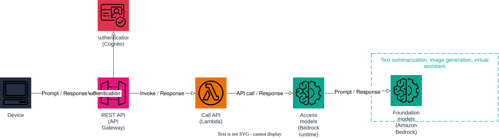

# AWS Project: Generative AI Model Access

The architecture offers a choice of high-performing, large deep learning models to build the generative AI applications you need. A device authenticates, then calls a single REST endpoint that routes prompts to the right Amazon Bedrock foundation model for text summarization, image generation, or virtual-assistant style chat.

1. a device authenticates through Cognito;
2. the device calls the model access API (API Gateway), which uses a Cognito authorizer;
3. API Gateway invokes the `access-models` Lambda function (the "Call API" step);
4. the Lambda function calls Amazon Bedrock (`bedrock-runtime`) and returns the model response — text summarization, image generation, or virtual assistant replies, depending on the requested task.

## Prerequisites

- Docker
- Terraform 1.5+
- AWS CLI

## Start Floci

```bash
docker compose up -d
```

## Apply Terraform

```bash
terraform init
terraform apply
```

## Architecture



The diagram source is a real, editable [draw.io](https://www.drawio.com/) file at [docs/architecture.drawio](docs/architecture.drawio), generated programmatically with the [drawpyo](https://github.com/MerrimanInd/drawpyo) Python library. Open the `.drawio` file directly on GitHub or with the draw.io desktop app / [app.diagrams.net](https://app.diagrams.net/) to edit it.

To regenerate the diagram (`.drawio` source + the `.svg`/`.png` embedded above) after changing the architecture:

```bash
python3 -m venv .diagram-venv
.diagram-venv/bin/pip install drawpyo
.diagram-venv/bin/python scripts/generate_diagram.py

# rasterize the .drawio file to svg/png (used by the README) via headless draw.io
docker run --rm -v "$PWD/docs":/data -w /data rlespinasse/drawio-export -f svg -o . --output-mode relative --remove-page-suffix .
docker run --rm -v "$PWD/docs":/data -w /data rlespinasse/drawio-export -f png -o . --output-mode relative --remove-page-suffix -t .
```

## Test the API

Create and confirm a Cognito user, then authenticate to get a JWT:

```bash
export USER_POOL_ID=$(terraform output -raw cognito_user_pool_id)
export CLIENT_ID=$(terraform output -raw cognito_client_id)

aws --endpoint-url http://localhost:4566 cognito-idp sign-up \
  --client-id "$CLIENT_ID" --username jane --password 'Passw0rd!'

aws --endpoint-url http://localhost:4566 cognito-idp admin-confirm-sign-up \
  --user-pool-id "$USER_POOL_ID" --username jane

TOKEN=$(aws --endpoint-url http://localhost:4566 cognito-idp initiate-auth \
  --client-id "$CLIENT_ID" --auth-flow USER_PASSWORD_AUTH \
  --auth-parameters USERNAME=jane,PASSWORD='Passw0rd!' \
  --query 'AuthenticationResult.IdToken' --output text)
```

Call the model access endpoint for each supported task:

```bash
API_URL=$(terraform output -raw api_endpoint)

# text summarization
curl -s -X POST "$API_URL/generate" \
  -H "Authorization: Bearer $TOKEN" \
  -d '{"task": "summarize", "prompt": "Summarize the benefits of serverless architectures."}' | jq

# virtual assistant
curl -s -X POST "$API_URL/generate" \
  -H "Authorization: Bearer $TOKEN" \
  -d '{"task": "assistant", "prompt": "How do I reset my password?"}' | jq

# image generation
curl -s -X POST "$API_URL/generate" \
  -H "Authorization: Bearer $TOKEN" \
  -d '{"task": "image", "prompt": "A watercolor painting of a mountain lake at sunrise."}' | jq
```

If you want to follow the execution, watch the Floci container logs:

```bash
docker compose logs -f floci
```

## Clean up

```bash
terraform destroy
docker compose down
```
